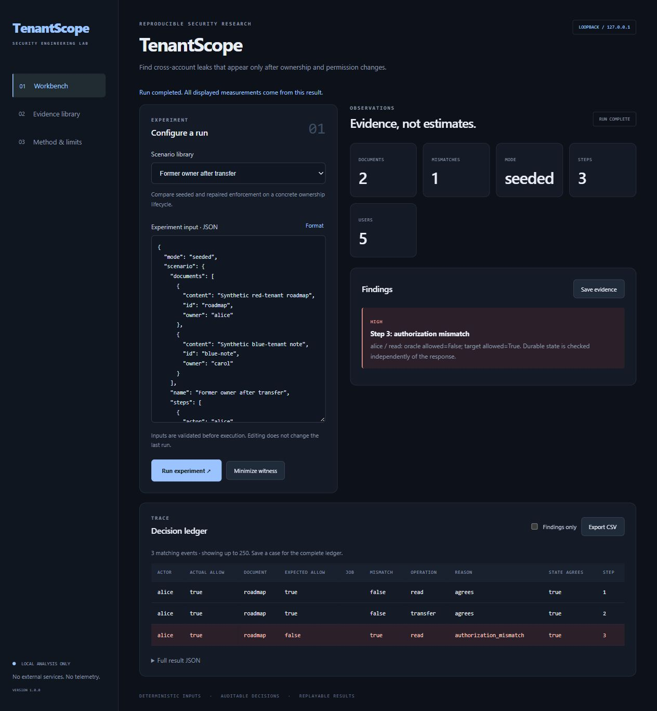

# TenantScope

**Authorization regression testing across ownership lifecycles.**

[](https://github.com/Ashin-06/TenantScope/actions/workflows/checks.yml)


TenantScope exposes authorization failures that appear after a permission change. A real SQLite fixture application and an independently implemented in-memory policy oracle process the same workflow. The runner compares decisions, returned content, and durable state after every step.

Seven reproducible defect/control pairs cover ownership transfer, revoked sharing, queued exports, cross-tenant attachments, disabled accounts, a write performed before denial, and deleted-document exports. A witness minimizer removes irrelevant steps while preserving the first failure’s actor/operation/resource/reason fingerprint.

All seven bundled scenarios expose a defect in **seeded** mode and pass in **repaired** mode. This is a controlled local harness with two implementations; it does not claim to scan arbitrary external services.

## Run locally

Requires Python 3.10+ on Windows, macOS, or Linux. Use a virtual environment. From the repository root:

```sh
python -m venv .venv
```

Activate with `.venv\Scripts\Activate.ps1` in PowerShell, or `source .venv/bin/activate` on macOS/Linux, then:

```sh
python -m pip install -e .
python -m tenantscope serve
```

Open **http://127.0.0.1:8762**. Select a scenario, edit JSON, run it, inspect findings and the decision ledger, export CSV, and save a replayable case. The Evidence library verifies saved cases and offers HTML reports and ZIP export. The UI is local, responsive, keyboard-accessible, and uses no external scripts or fonts.



## Reproduce from the CLI

```sh
python -m tenantscope demo --output .lab/demo-case
python -m tenantscope verify .lab/demo-case
python -m tenantscope bundle .lab/demo-case .lab/demo-case.zip
python -m tenantscope run examples/transfer.json --output .lab/custom-case
python -m tenantscope benchmark
```

Output destinations must be new; existing evidence is never overwritten. `presets` prints all runnable inputs. Run `python -m tenantscope --help` for the command reference. Exit code 0 means the command completed, 1 means evidence verification failed, and 2 means invalid input or an operational error. A completed experiment may contain findings; inspect the JSON summary rather than interpreting exit 0 as a clean security verdict.

```sh
python -m tenantscope minimize examples/transfer.json
```

Change `"mode": "seeded"` to `"mode": "repaired"` in a copy of a scenario to compare the control implementation.


## Evidence and methodology

Every saved case includes canonical input/result JSON, a standalone escaped HTML report, and a SHA-256 manifest. Verification checks hashes **and replays the experiment**. Reports display up to 200 ledger rows; the dashboard displays up to 250; result JSON retains the complete bounded ledger. CSV export includes all events matching the current filter and neutralizes spreadsheet formula prefixes.

- [Method, input contract, and limits](docs/METHOD.md)
- [Threat model](THREAT_MODEL.md)
- [Recorded benchmark results](docs/benchmark-results.json) — regenerate with `benchmark`
- [API and architecture](docs/ARCHITECTURE.md)
- [Contributing and validation](CONTRIBUTING.md)

## Validation

[Version 1.0.1 validation details](docs/VALIDATION.md) records regression coverage and the manual browser checks. Replay requires the software version recorded in the case manifest; use the matching release tag for older evidence.

```sh
python -m unittest discover -s tests -v
python -m pip install ruff
python -m ruff check --select F,E9 .
```

GitHub Actions runs tests, static checks, JavaScript syntax validation, and all fixture benchmarks on Python 3.10/3.12 for Windows and Ubuntu. Browser behavior is manually checked separately. These projects are research workbenches with explicit model limits; a passing fixture suite is not a production security assessment.

## License

[MIT](LICENSE). Maintained by [Ashin-06](https://github.com/Ashin-06).
